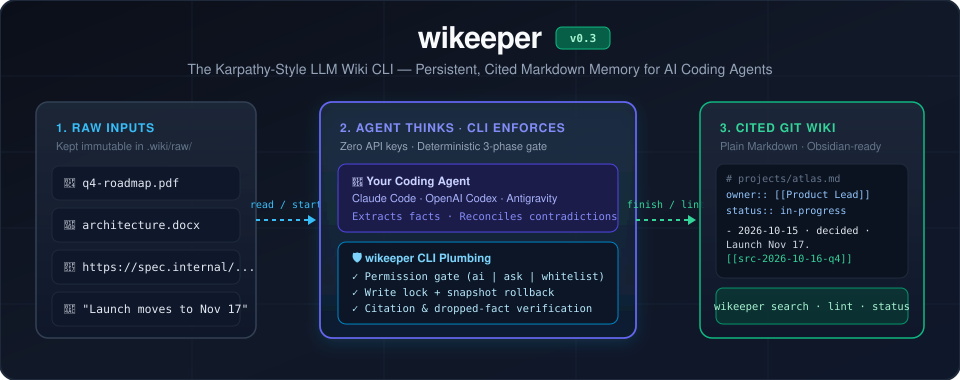
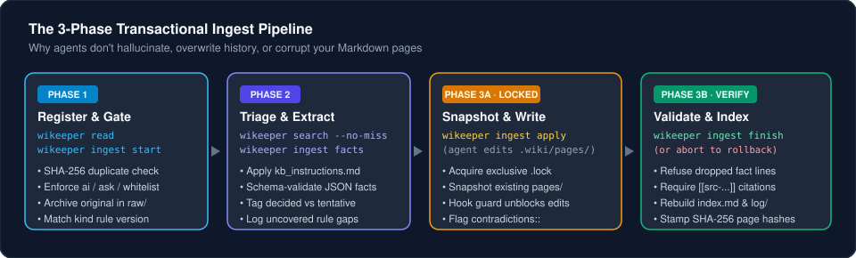
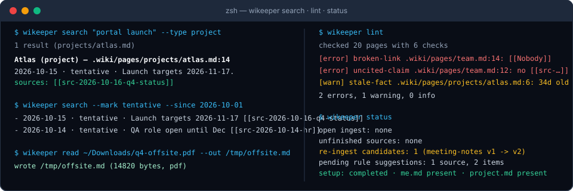

<div align="center">



# wikeeper

### **Give Claude Code, OpenAI Codex, and Google Antigravity a memory they maintain themselves.**

*A deterministic, Git-native **Karpathy-style LLM Wiki CLI** that turns your PDFs, Word docs, links, and chat decisions into an interlinked, cited Markdown knowledge base—with **zero LLM API keys** and **no vector database**.*

[](https://www.npmjs.com/package/wikeeper)
[](https://github.com/sandrinio/wikeeper/actions/workflows/ci.yml)
[](https://nodejs.org)
[](LICENSE)

[**Quickstart**](#-60-second-quickstart) · [**Why Not Just Prompts or RAG?**](#-why-wikeeper-instead-of-rag-or-raw-markdown) · [**How It Works**](#-how-it-works-the-agent-thinks-the-cli-enforces) · [**Commands**](#-cli-command-reference) · [**Architecture**](architecture.md)

</div>

---

## 🧠 The Problem: AI Agents Have Amnesia (and Unchecked Wikis Decay)

Every session with **Claude Code**, **Codex**, or **Antigravity** starts from zero.

If you stuff everything into `CLAUDE.md` or `AGENTS.md`, you bloat every prompt. If you tell an agent *"just maintain a folder of Markdown notes"* (the raw **Karpathy LLM Wiki** pattern), it works for the first 10 files—and then decays:
- Agents **silently overwrite** historical facts when rewriting a page.
- Claims lose provenance—you can't tell *which* meeting note or PDF a date came from.
- Broken `[[wikilinks]]`, orphan pages, and stale statuses pile up undetected.

**`wikeeper` fixes the decay mechanically.** Your coding agent still does all the reading, extraction, and writing—while the `wikeeper` CLI enforces **permissions, transactional write locks, snapshots, source citations, full-text search, and wiki linting**.

---

## ⚡ 60-Second Quickstart

Install and wire up your repository with a single command:

```bash
npx wikeeper init
```

`wikeeper init` scaffolds `.wiki/`, injects a short pointer block into your existing `CLAUDE.md`, `AGENTS.md`, or `GEMINI.md`, and installs native agent skills (`wiki-ingest`, `wiki-search`) and sub-agents (`wiki-extractor`, `wiki-writer`).

Next, open **Claude Code**, **Codex**, or **Antigravity** and talk naturally:

```text
You:   "Hi! Let's finish setting up the wiki."
Agent: → Runs interactive onboarding (.wiki/me.md + .wiki/project.md)
       → Tailors capture rules in .wiki/kb_instructions.md

You:   "Here is our Q4 roadmap PDF and the notes from yesterday's standup."
Agent: → Converts PDF via `wikeeper read`
       → Extracts cited facts via `wikeeper ingest`
       → Updates .wiki/pages/projects/atlas.md & .wiki/pages/risks.md

You:   "What slipped since October 1st, and who owns the vendor risk?"
Agent: → Queries `wikeeper search --since 2026-10-01`
       → Answers with exact source citations: [[src-2026-10-16-q4-status]]
```

---

## 🛡️ How It Works: The Agent Thinks, The CLI Enforces



1. **Read Anything (`wikeeper read`):** Converts **PDFs** (with scanned-deck detection), **DOCX** (preserving GFM tables), **web URLs**, **HTML**, and **CSV/text** into clean Markdown with title, author, and date headers.
2. **Pre-Hook Gate (`wikeeper ingest start`):** Checks SHA-256 duplicates, enforces your permission mode (`ai` / `ask` / `whitelist`), and archives the immutable original in `.wiki/raw/`.
3. **Structured Triage (`wikeeper ingest facts`):** Your agent extracts dated facts (`decided` or `tentative`) governed by your `.wiki/kb_instructions.md` rules and validates them against a strict JSON schema.
4. **Locked Write Phase (`wikeeper ingest apply` → `finish`):**
   - Takes an exclusive write lock and snapshots `.wiki/pages/`.
   - **Never loses history:** `finish` **refuses** any page edit that drops an existing fact line or omits a `[[src-...]]` citation. Contradictions are flagged (`contradicts:: [[src-...]]`), never overwritten.
   - Automatically rebuilds `.wiki/index.md`, writes a merge-safe event to `.wiki/log/`, and runs post-ingest lint checks.

---

## 🖥️ Terminal Preview: Search, Read, Lint & Status



Every command outputs human-friendly reports in the terminal and supports `--json` for deterministic agent parsing.

---

## 🔍 Why `wikeeper` Instead of RAG or Raw Markdown?

| Feature | Vector RAG / Cloud Memory *(Mem0, Letta)* | Prompt-Only Markdown Wiki *(Raw Karpathy Gist)* | **`wikeeper`** |
| :--- | :--- | :--- | :--- |
| **API Keys / LLM Cost in Tool** | Requires OpenAI / Anthropic API keys & DB | None | **Zero.** Uses the coding agent you already run |
| **Storage Format** | Opaque vector embeddings / SQLite / Cloud | Local `.md` files | **100% Git-native `.md` + Obsidian `[[links]]`** |
| **Accidental Fact Deletion** | Black-box memory mutation | Agents lazily overwrite old bullets | **Blocked by `finish` snapshot diff check** |
| **Source Provenance** | Fuzzy chunk similarity | Honor-system citations | **Enforced `[[src-...]]` citation on every claim** |
| **Direct File-Edit Protection** | N/A | None | **Opt-in `--enforce` tool hooks block rogue edits** |
| **Wiki Health & Decay** | Silent embedding drift | Broken links & orphan pages pile up | **`wikeeper lint` & `lint --rules` catch decay** |
| **Capture Rule Evolution** | Hardcoded extraction prompts | Static prompt | **Versioned `kb_instructions.md` + fingerprinted rule memory** |

---

## 🔐 Permission Modes & Harness Enforcement

You control what enters your knowledge base via `ingest.permission` in `.wiki/config.yml`:

| Mode | Behavior |
| :--- | :--- |
| **`ask`** *(default)* | Every ingest pauses and shows source metadata (`size`, `kind`, matched rule version) for your approval before storing. |
| **`whitelist`** | Sources matching your trusted path globs (`docs/meetings/**`) or domains (`*.example.com`) and kinds run automatically; everything else is denied. |
| **`ai`** | Your agent ingests autonomously—while still prompting before destructive actions (`abort --drop` or `apply --force-unlock`). |

> [!TIP]
> **Mechanical Guardrails (`--enforce`):** Run `wikeeper init --enforce` to install native `PreToolUse` hooks and permission rules into Claude Code and Codex. If an agent tries to edit `.wiki/pages/` outside a locked write phase, the hook blocks the edit automatically—and `wikeeper lint` backs it up with SHA-256 `unlogged-change` detection.

---

## 📏 Token Gauges

Every size `wikeeper` shows is an estimate in tokens, printed with `≈` and within about ±15% of Claude's count. A source is 🟢, 🟡 or 🔴 against `tokens.source` (20k and 60k by default), a page against `tokens.page` (4k and 10k); the wiki total has no level. When a source reaches `tokens.source.confirm_at` (yellow by default), `wikeeper ingest start` asks for your approval before the source is read, in every permission mode. Change a limit with `wikeeper config set`, for example `wikeeper config set tokens.page.red 12k`; `wikeeper statusline` prints the wiki's size on one line.

---

## 🧰 CLI Command Reference

| Command | Description |
| :--- | :--- |
| `wikeeper init [--profile management] [--enforce]` | Scaffold `.wiki/`, wire up `CLAUDE.md` / `AGENTS.md` / `GEMINI.md`, and install skills & sub-agents |
| `wikeeper read <file\|url> [--out <file>]` | Convert PDF, DOCX, web URLs, HTML, Markdown, or CSV into clean Markdown, with its estimated size |
| `wikeeper ingest start · plan · facts · apply · finish · abort` | Run the 3-phase transactional ingest pipeline (or `--dry-run` on `facts` to preview rule changes) |
| `wikeeper search [query]` | Full-text BM25 + structured search (`--type`, `--where`, `--status`, `--mark decided\|tentative`, `--entity`, `--since`, `--misses`) |
| `wikeeper lint [--rules] [--check <id>]` | Check pages (`broken-link`, `uncited-claim`, `orphan-page`, `index-drift`, `unlogged-change`, `stale-fact`, `oversized-page`) or validate `kb_instructions.md` |
| `wikeeper status` | Show active locks, unfinished sources, re-ingest candidates (from rule upgrades), pending rule suggestions, search misses, and the `tokens` section (the wiki's size and its largest pages) |
| `wikeeper rules record · list` | Record `--accepted` or `--rejected` rule proposals with SHA-256 fingerprints so rejected ideas are never re-offered |
| `wikeeper config get · set · unset` | Read and change the token limits in `.wiki/config.yml` |
| `wikeeper statusline [--install]` | Print the wiki's size on one line; `--install` adds it to Claude Code's status line |
| `wikeeper doctor` | Verify agent wiring, setup files (`me.md`, `project.md`), hook rules, and `kb_instructions.md` syntax |
| `wikeeper update` / `wikeeper remove [--purge]` | Upgrade package-owned system files and skills without touching your knowledge base |

---

## 🤝 Multi-Agent Compatibility

`wikeeper` works identically across the three major AI coding harnesses—and lets mixed teams collaborate on the same Git wiki:

| Capability | Claude Code | OpenAI Codex | Google Antigravity |
| :--- | :--- | :--- | :--- |
| **Root Instructions** | `CLAUDE.md` | `AGENTS.md` | `AGENTS.md` / `GEMINI.md` |
| **Installed Skills** | `.claude/skills/` | `.agents/skills/` | `.agents/skills/` |
| **Extractor & Writer Sub-Agents** | `.claude/agents/` | `.codex/agents/` | `.agents/agents/` |
| **Harness Enforcement (`--enforce`)** | `.claude/settings.json` (`PreToolUse` + `allow`/`ask`) | `.codex/hooks.json` + `.codex/rules/wikeeper.rules` | CLI gate + `unlogged-change` lint check |

---

## 📋 Built for Technical Management, Product & Engineering

Out of the box, `wikeeper` ships with the **Management** profile:
- **Personal Context (`.wiki/me.md`):** Gitignored profile of your name, role, and aliases—so *"Action: PM to send budget"* in meeting notes is recognized as **your** action item.
- **Shared Project Brief (`.wiki/project.md`):** Committed core terms and scope shared across the repo.
- **Self-Evolving Rules (`.wiki/kb_instructions.md`):** Maps your key questions (`Q1`, `Q2`...) to entities (`project`, `person`, `risk`, `decision`) and versioned source kinds (`meeting-notes (v2)`). When you upgrade a rule from `v1` to `v2`, `wikeeper status` automatically flags older sources as re-ingest candidates and lets you preview the diff with `wikeeper ingest facts <id> --dry-run`.

---

## 📦 Requirements & Development

- **Node.js** `>= 22.12.0`

```bash
npm install
npm test          # Unit, structural, and acceptance suite
npm run test:perf # Search, cache and status-line performance benchmarks
npm run build     # TypeScript build + commit stamp
```

Planned and built in the open with [ClearGate](https://www.npmjs.com/package/cleargate). Full specification and decision log (`D-01`–`D-31`) in [`architecture.md`](architecture.md).

## License

[MIT](LICENSE) © Sandro Suladze
